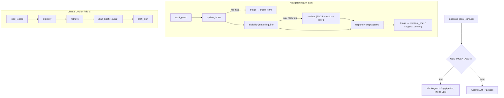

# Bản đồ AI Core

AI Core là package Python được backend gọi qua `ai_core.api`; không chạy server riêng. Trạng thái phiên tư vấn, lịch hẹn,
lần khám, hồ sơ xuyên suốt và phân quyền nằm ở backend. Xem [contract](../docs/protocols/AI_CORE_CONTRACT.md).

## Luồng xử lý

## Các file chính

| File | Vai trò |
|---|---|
| `ai_core/api.py` | Interface duy nhất cho backend: `Agent`, `get_agent`, helpers (`list_services`, `intake_from_profile`, `merge_intake`, `CANCER_LABEL_VI`…) |
| `ai_core/mock.py` | `MockAgent` = `Agent(use_llm=False, dense=False)` |
| `ai_core/schemas.py` | Contract Pydantic: `IntakeProfile`, `NavigatorReply`, `PatientRecord`, `ClinicalBrief`, `ScreeningPlan`… kèm invariant |
| `ai_core/agents/navigator.py` | LangGraph Navigator, câu trả lời mẫu xác định, guard đầu ra cho LLM |
| `ai_core/agents/copilot.py` | LangGraph Copilot (brief) + hỏi đáp có trích dẫn guideline/hồ sơ |
| `ai_core/tools/intake.py` | Trích xuất thông tin tiếng Việt (có/không dấu, phủ định, người thân vs bản thân) |
| `ai_core/tools/red_flag_detector.py` | Red-flag từ bảng hỏi và văn bản tự do (`data/red_flags.json`) |
| `ai_core/tools/eligibility.py` | Bộ luật tầm soát (`data/screening_rules.json`) → gợi ý có nguồn + yếu tố nguy cơ |
| `ai_core/tools/triage.py` | `next_action` + dịch vụ gợi ý (`data/services.json`) |
| `ai_core/tools/questionnaire.py` | Bảng hỏi nhanh (`data/questionnaire.json`), `depends_on` |
| `ai_core/tools/patient_qa.py`, `tools/education.py` | Hỏi đáp về kế hoạch đã duyệt; nội dung giáo dục từ guideline |
| `ai_core/tools/booking.py`, `tools/recall_reminder.py` | Tính chu kỳ nhắc lịch, soạn lời nhắc |
| `ai_core/rag/corpus.py` | Đọc guideline + frontmatter, chunk theo mục (400/40) với header ngữ cảnh |
| `ai_core/rag/lexical.py`, `rag/retriever.py` | BM25 (bỏ dấu + bigram), vector Chroma, RRF, lọc metadata, hạ cấp khi thiếu index |
| `ai_core/rag/ingest.py`, `rag/embeddings.py` | Nạp Chroma; embedding local đa ngôn ngữ hoặc OpenAI |
| `ai_core/guardrails/safety.py` | Ngoài phạm vi, injection, ngôn ngữ chẩn đoán, con số không có nguồn, validate plan |
| `ai_core/observability.py` | trace_id, event từng node, log JSON, `add_sink` |
| `ai_core/evaluation.py`, `data/eval/navigator_cases.json` | Golden set và chỉ số |
| `ai_core/prompts.py` | Toàn bộ prompt (để audit an toàn) |
| `data/guidelines/`, `data/raw_data/` | Bản tóm tắt guideline đã biên tập; tài liệu gốc + xuất xứ |
