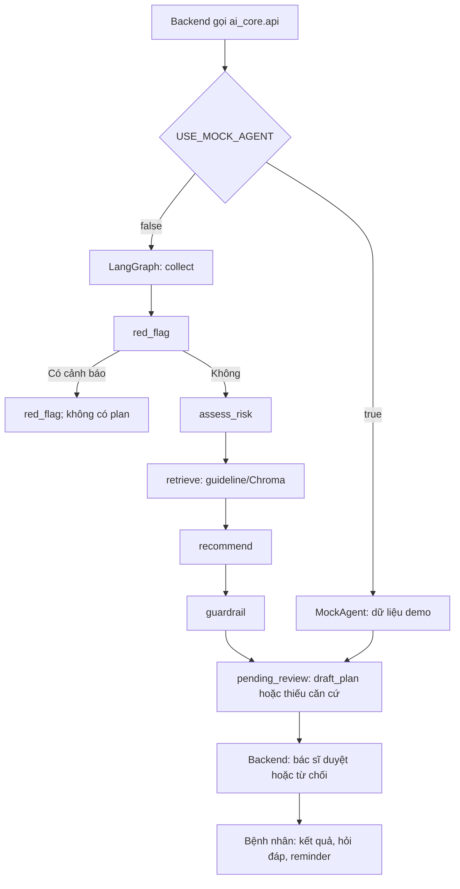

# Bản đồ AI Core và các use case

AI Core là package Python được backend gọi qua `ai_core.api`; không chạy server riêng. Trạng thái phiên, phân quyền, bác sĩ duyệt và reminder nằm ở backend. Xem [contract](../docs/protocols/AI_CORE_CONTRACT.md) và [hướng dẫn tích hợp](../docs/guides/GUIDE_INTEGRATION.md).

## Luồng xử lý



Không có nguồn RAG phù hợp vẫn chạy qua `recommend` và `guardrail`, trả `draft_plan=null`. Lỗi LLM cũng chuyển sang thiếu căn cứ. Trace gồm node, trạng thái, thời lượng và số nguồn, không chứa câu trả lời bệnh nhân hoặc API key. Khi thiếu câu bắt buộc, backend giữ phiên ở `collecting` trước khi gọi graph; red-flag được kiểm tra trên mỗi lần gửi câu trả lời.

## Các file chính

| File | Vai trò |
|---|---|
| `ai_core/api.py` | Interface duy nhất backend import: questionnaire, red-flag, screening, education, hỏi đáp kế hoạch và chat kiến thức chung. |
| `ai_core/schemas.py` | Pydantic contract; `ScreeningResult` cho phép pending không có plan, `PlanItem.next_due` có thể rỗng. |
| `ai_core/config.py` | Đọc `.env` root; đường dẫn vector store tương đối được chuẩn hóa theo root repo. |
| `ai_core/llm.py` | Tạo model OpenRouter, OpenAI, Anthropic hoặc Ollama. OpenRouter dùng endpoint tương thích OpenAI. |
| `ai_core/prompts.py` | Prompt đánh giá nguy cơ, kế hoạch và hỏi đáp; giới hạn phạm vi, cấm chẩn đoán. |
| `ai_core/mock.py`, `ai_core/cli.py` | Agent demo có dữ liệu mẫu và lệnh chạy độc lập. |
| `ai_core/graph/build.py`, `graph/state.py` | LangGraph, điều kiện rẽ nhánh red-flag, tracing node và đổi state sang contract. |
| `ai_core/graph/nodes/*` | Sáu node: `collect`, `red_flag`, `assess_risk`, `retrieve`, `recommend`, `guardrail`. |
| `ai_core/rag/ingest.py`, `rag/embeddings.py`, `rag/retriever.py` | Chia chunk guideline, tạo embedding, lưu và truy vấn Chroma; lọc giới/tuổi/nguy cơ. |
| `ai_core/tools/questionnaire.py`, `tools/red_flag_detector.py` | Câu hỏi phụ thuộc và cảnh báo triệu chứng theo quy tắc, chạy trước LLM. |
| `ai_core/tools/screening_recommender.py` | LLM tạo đề xuất có cấu trúc; chỉ giữ item có nguồn truy xuất và chu kỳ. |
| `ai_core/tools/patient_qa.py`, `tools/education.py` | Giải thích kế hoạch đã duyệt và chat kiến thức chung có nguồn; nội dung giáo dục từ Markdown đã biên tập. |
| `ai_core/tools/booking.py`, `tools/recall_reminder.py` | Tính chu kỳ theo tháng lịch và soạn thông báo cho backend scheduler. |
| `ai_core/guardrails/*` | Disclaimer và kiểm tra ngôn ngữ chẩn đoán/nguồn của plan. |
| `data/questionnaire.json`, `data/red_flags.json` | Dữ liệu cho câu hỏi và quy tắc red-flag. |
| `data/raw_data/`, `data/guidelines/`, `data/vector_store/` | Nguồn thô; Markdown đã biên tập; Chroma sinh khi ingest (không commit). |
| `scripts/ingest.py`, `tests/` | CLI ingest và kiểm tra schema, graph, RAG, guardrails, hỏi đáp. |

## Từng use case

1. **Khảo sát nhiều vòng:** backend lấy questionnaire, merge câu trả lời theo `question_id`, kiểm tra red-flag; thiếu câu bắt buộc thì giữ `collecting`.
2. **Red-flag:** detector rule-based ngắt trước LLM/RAG; FE hiển thị cảnh báo, không tạo plan.
3. **Agent thật có RAG:** sáu node chạy, chỉ tạo bản nháp có nguồn. Nếu index trống hoặc nguồn không phù hợp, bác sĩ nhận phiên thiếu căn cứ để quyết định.
4. **Ingest:** biên tập `data/guidelines/*.md` có frontmatter rồi chạy `python scripts/ingest.py`; `--reset` chỉ khi muốn tạo lại collection.
5. **Bác sĩ duyệt:** backend lưu trace và bản nháp; bác sĩ có thể sửa, duyệt, từ chối hoặc xác nhận không đủ căn cứ bằng ghi chú. Bệnh nhân chỉ thấy kết quả sau duyệt.
6. **Giáo dục và hỏi đáp:** trang giáo dục dùng nội dung guideline đã biên tập; Q&A chỉ dựa trên kế hoạch đã duyệt, trả thiếu thông tin khi không đủ căn cứ.
7. **Nhắc lịch:** backend tạo reminder cho mục có ngày `next_due`. Khi bệnh nhân đánh dấu hoàn thành, helper tính ngày chu kỳ tiếp theo từ `interval_months` bác sĩ đã duyệt.

## Chạy độc lập và IDE

```bash
cd ai_core
python3 -m venv .venv
source .venv/bin/activate
python -m pip install -e ".[dev,local-embed,openai]"
python -m ai_core.cli demo
python -m ai_core.cli demo --real
```

`demo --real` cần key/model của provider đúng và credit nếu chọn model có phí; backend cần `USE_MOCK_AGENT=false`. Khi chưa ingest, agent vẫn hoàn tất graph và chuyển sang thiếu căn cứ. VS Code có thể dùng Python, Pylance, Ruff và Python Debugger; chọn interpreter `ai_core/.venv/bin/python`.
